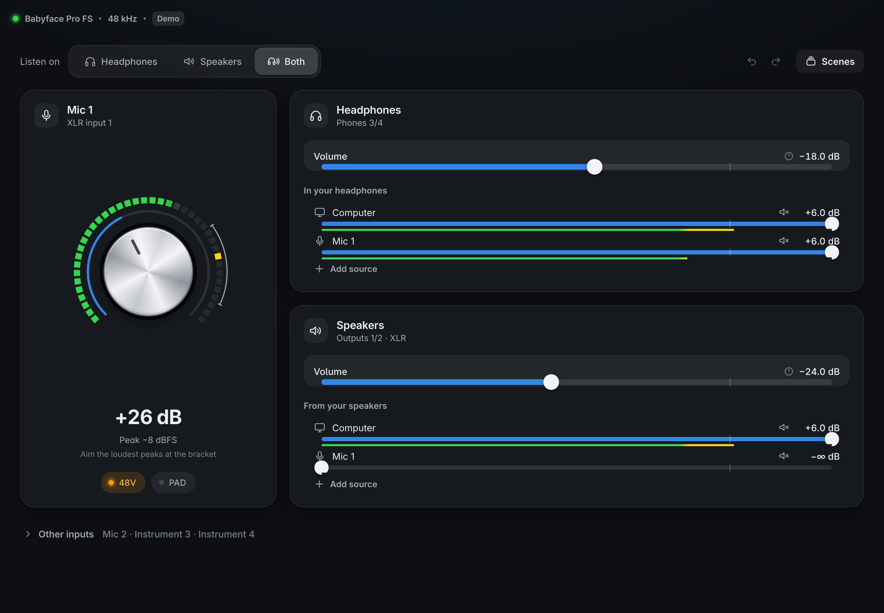
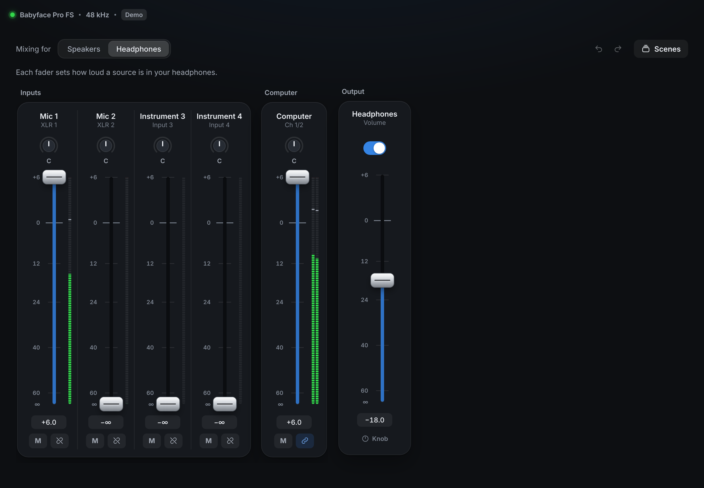
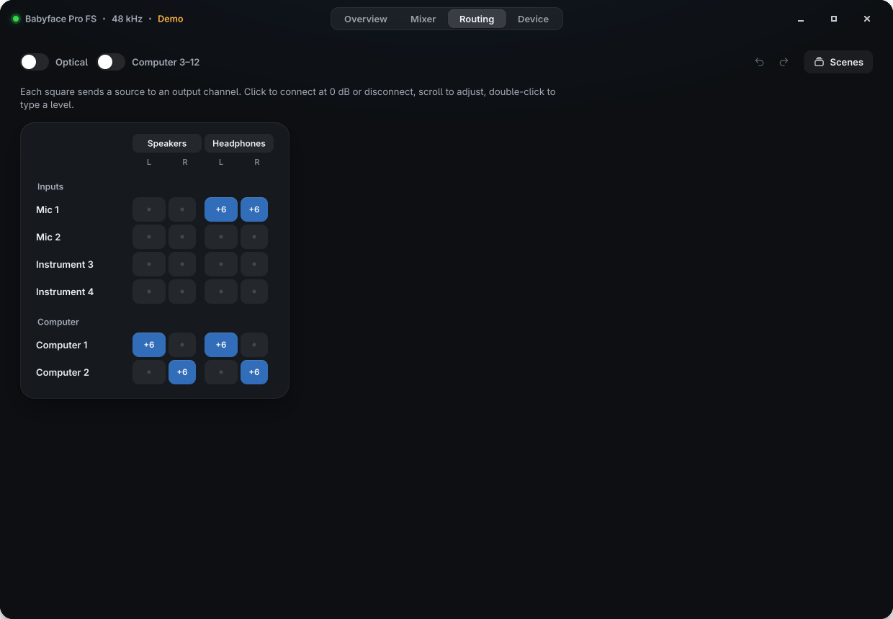
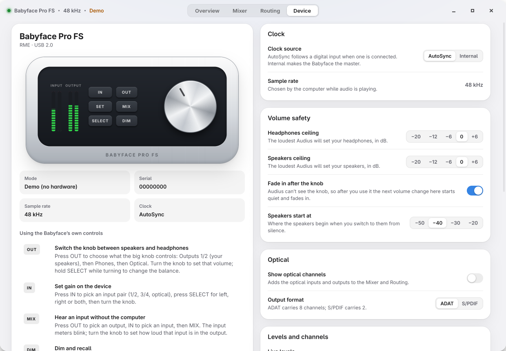
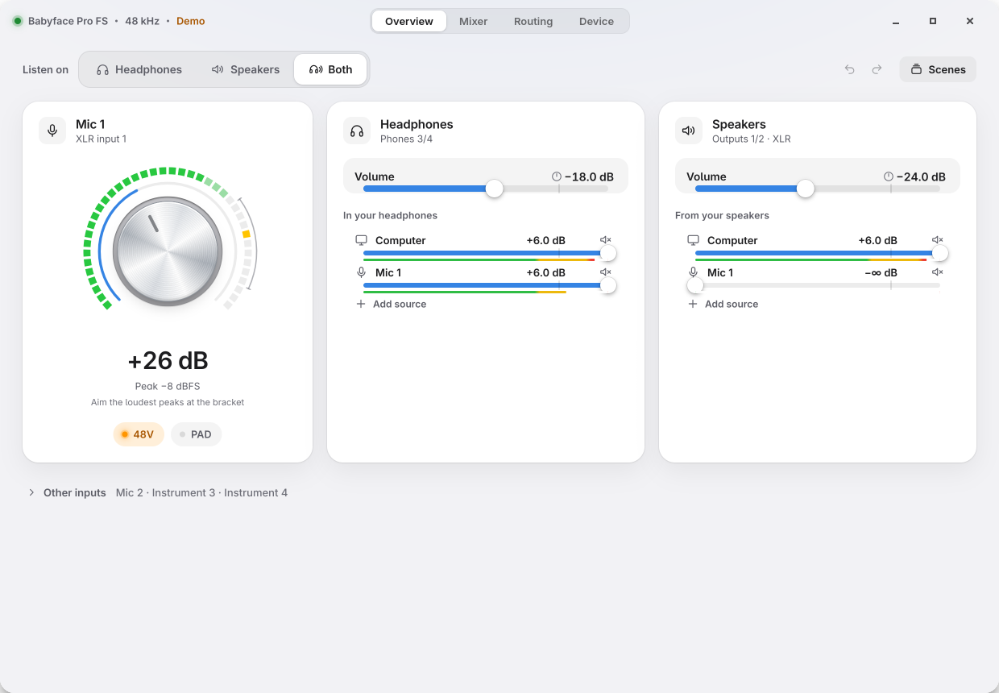

# Audius

A control panel for the **RME Babyface Pro FS in Class Compliant mode** on Linux, the setup where
TotalMix FX doesn't exist. Set your mic gain while watching its level, choose whether you listen on
headphones or speakers, balance what you hear, and reach the full routing matrix when you need it.



## What it does

**Overview**: the everyday screen.
- **Listen on Headphones · Speakers · Both.** One switch instead of hunting through crosspoints.
  Switching to speakers from silence starts them at a safe −40 dB.
- **Mic gain dial** modelled on the Babyface's own encoder, with the live input level wrapped around
  it as LEDs, a bracket where RME says your loudest peaks should land (−12 to −3 dBFS), a latched
  clip warning, **48V** (asks first) and **PAD**.
- **Headphones and Speakers cards**: volume, plus what you hear in each, with per-source level bars
  (computer, mic, …). Add or remove sources per card.

**Mixer**: TotalMix's model, made explicit. Pick the output you're mixing *for*; every input and
computer channel gets a fader, pan, mute and meter. Link pairs to stereo. The output's volume sits at
the end.

**Routing**: the whole matrix as a grid. Click a square to connect at 0 dB, scroll to trim,
double-click to type a level, arrow keys to move around.

**Device**: an illustration of your Babyface that explains its own keys (how **OUT** switches the
knob between speakers and headphones, how **IN**/**MIX**/**DIM** work), clock source, optical format,
volume ceilings, live-level settings and a "resend to the Babyface" for power-cycled units.

Also: **Scenes** (save a mix, recall it with every fader gliding into place), **undo/redo**
(`Ctrl+Z` / `Ctrl+Shift+Z`), light and dark appearance following GNOME, your GNOME accent colour,
full keyboard control.

| | |
|---|---|
|  |  |
|  |  |

## Safety

Audius talks to the same kernel controls as alsamixer, which can only *write* to the Babyface; the
device never reports back. Its front-panel knob changes things Audius can't see. So:

- **Nothing is written on startup.** Audius only shows what the driver last sent.
- **Volume changes fade in.** If Audius hasn't set an output in the last 45 s (or you've been in
  another window, possibly turning the knob), the next change fades in from −60 dB over 0.7 s
  instead of jumping. Each output has a **ceiling** you choose (default 0 dB).
- **Headphones/Speakers on and off** work through the routing, never the volume, so they don't fight
  the knob.
- **48V** asks before switching on. Scenes and undo never touch volume or 48V.

## Install

Needs Fedora (or similar) with GNOME's usual stack: `python3-gobject gtk4 libadwaita webkitgtk6.0
gstreamer1-plugins-good pipewire-gstreamer pipewire-utils` (all present on Fedora Workstation).

```sh
./install.sh             # installs for your user: app grid entry, icon, `~/.local/bin/audius`
./install.sh --uninstall
```

An RPM spec lives in `build-aux/audius.spec`; CI builds the RPM on every push.

The Babyface must be in Class Compliant mode: hold **SELECT** and **DIM** while connecting USB
(the meters show "CC").

## The kernel driver bug

While building this I found that the kernel's Babyface Pro mixer quirk stores each control as
`index | value << 9` with a 10-bit index. Writing an *odd* value to a routing control sends every
later write to the wrong DSP address, and output volumes always read back off by one.
Audius only writes even values and reads around it. Details, the one-line upstream fix and a
cleanup for already-affected controls are in [docs/KERNEL-BUG.md](docs/KERNEL-BUG.md).

## How it's built

- `audius/alsa.py`: ctypes binding to libasound's control API (read, write, change events).
- `audius/babyface.py`: the Babyface's 314 controls, dB maths, and a writer thread that coalesces
  writes and runs smooth dB-linear ramps off the UI thread.
- `audius/mixer.py`: stereo pairs and pan, output on/off memory, the knob-aware volume takeover,
  scenes and gesture-grouped undo. Unit tested (`python3 -m unittest discover -s tests`).
- `audius/meters.py`: live levels from PipeWire via GStreamer's `level` element, only while the
  window is visible (GNOME shows its microphone indicator meanwhile).
- `audius/app.py`: the native GTK 4 window (transparent header bar, real window controls) hosting
  the interface in WebKitGTK through a custom `audius://` scheme; messages go both ways.
- `audius/ui/`: the interface: plain HTML, CSS and JavaScript modules, no build step.

Settings live in `~/.config/audius/config.json`. The mixer state itself is kept by ALSA
(`alsa-state.service`).

### Development

```sh
./audius-run --demo                       # no hardware needed, simulated signals
./audius-run --debug                      # web inspector, console output
./audius-run --demo --page mixer --theme light --screenshot out.png --size 1240x860
python3 -m unittest discover -s tests
```

See [docs/PLAN.md](docs/PLAN.md) for the design and architecture notes.

---

RME, Babyface and TotalMix are trademarks of RME Audio AG. Audius is an independent project.
